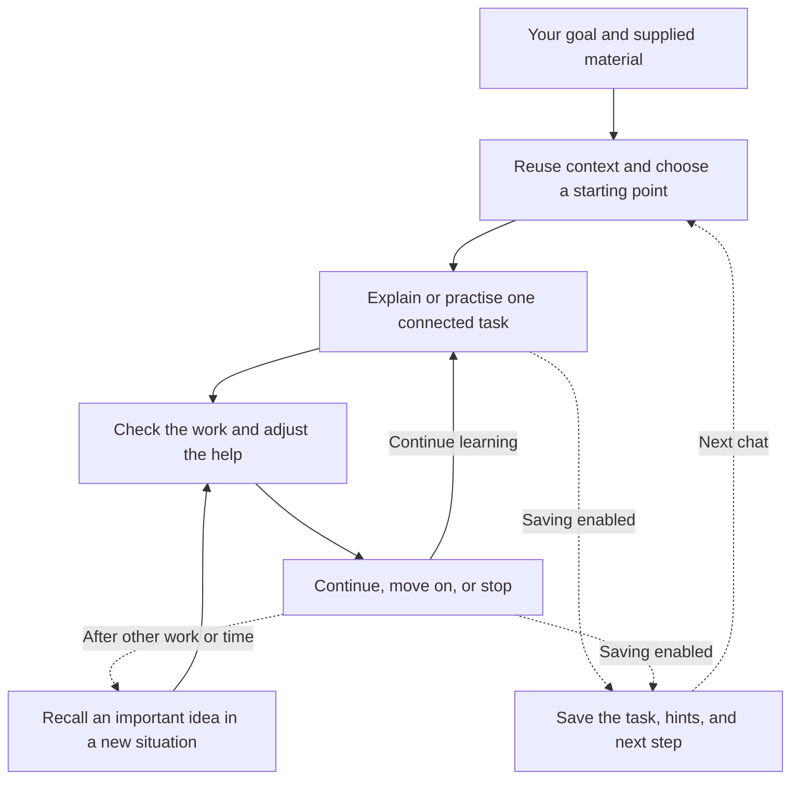
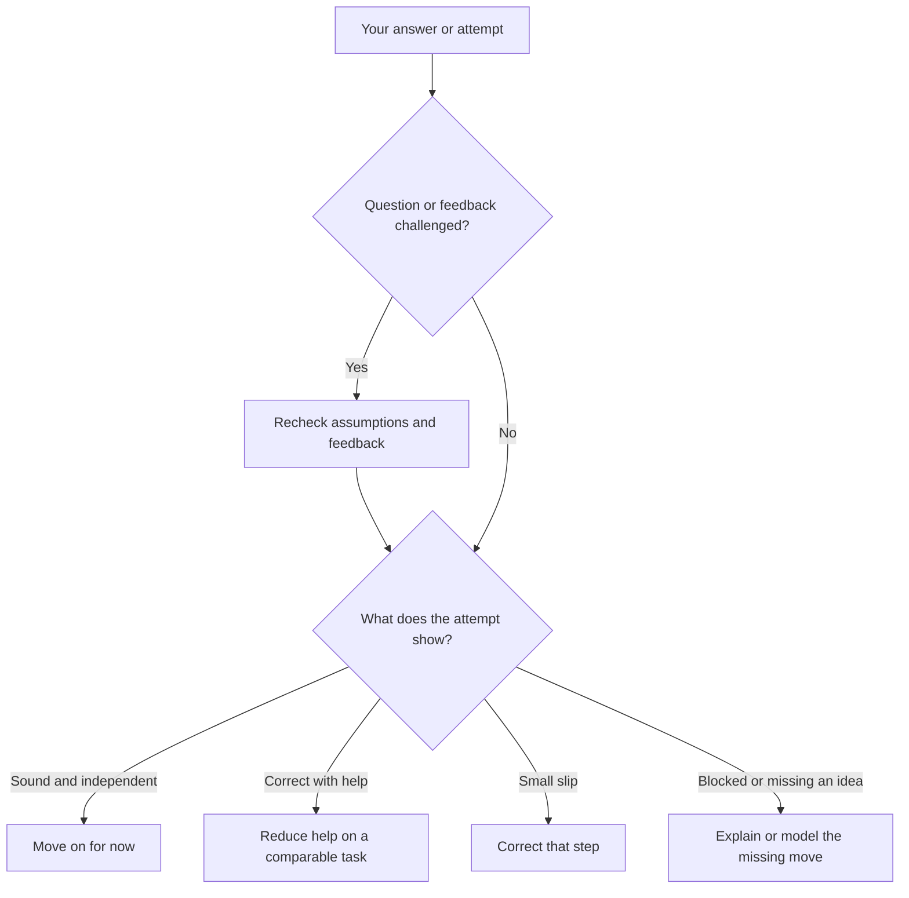

# Adaptive Learn

A tutoring skill for OpenCode that adjusts explanations, hints, and practice to the work you show. Study for class, cram, or learn in depth, with optional progress across chats.

**Experimental:** file handling has automated tests; teaching still needs live checks. Correct feedback, faster learning, and lasting mastery are not guaranteed.

## Quick start

Open the folder containing `SKILL.md` in OpenCode and ask:

> Read SKILL.md and help me learn linear equations for class. Start with a useful problem. Use session-only learning for now.

You can request practice, review, or a direct explanation. Supply relevant notes, assignments, or exam materials. There is no compulsory placement test or long intake interview.

You need OpenCode with a configured model. Saving and resuming require Python 3.10 or newer, with no extra packages. Session-only tutoring can work without Python. Git is optional for privacy checks.

Local use does not require global installation. If you later want automatic skill discovery, see [installation](#installation).

## Choose how you want to study

| Goal | What the tutor prioritizes | Example request |
| --- | --- | --- |
| Cramming | Useful coverage within your available effort, important gaps, concise examples, and exam-like practice. It should say what remains uncovered. | "I have 45 minutes to cram these objectives." |
| Learning for class | Your course material and assessment criteria, with enough understanding to apply ideas independently and recall them later. | "Help me understand this week's lecture and practise for the assignment." |
| Learning in depth | Explanations, mechanisms, connections, unfamiliar applications, and the limits of an idea. | "Help me understand why this works, including when it stops working." |

Switching goals preserves recorded progress. Help still depends on your work: a beginner can study in depth, and an experienced learner can cram. An exam paper alone establishes neither urgency nor complete coverage.

### In-depth learning and the Feynman-inspired activities

The tutor can work through these activities where useful:

1. Explain the idea in everyday language with a concrete example.
2. Find a missing step or unclear term, teach it, and improve the explanation.
3. Apply the idea independently to a new case.
4. Test assumptions, counterexamples, or a different application.

Skip activities you have already demonstrated. These are not mastery scores; explaining fluently does not prove you can apply an idea. See [study goals](references/study-goals.md).

## The learning workflow



The tutor reuses known information and skips redundant steps. You should have room to work through a meaningful task without constant interruption.

1. **Choose a useful target:** something you should be able to do. Ask only clarifications that change the next action.
2. **Start near that task:** a representative attempt can reveal where to begin. If you cannot start, explain or demonstrate enough to help.
3. **Teach the blocking part:** use examples, direct instruction, or useful questions. Define unfamiliar terms and symbols before relying on them.
4. **Reduce help when ready:** move from examples or partial tasks toward independent work, skipping support you no longer need.
5. **Move on for now, then revisit:** independent success supports progress. Important correct answers, errors, and assisted successes can all need later review.

Practice works under any goal. Named-method drills teach execution; later tasks can test choosing the method. An immediate copy after a hint does not establish later recall.

## How the tutor chooses the next move



The tutor should make these decisions without a repeated questionnaire. Ambiguous work may need one useful follow-up.

- Typing speed and confidence alone do not establish understanding. Hint-assisted success remains assisted evidence.
- Objective problems need checked solutions. Writing, interpretation, and design need relevant criteria that allow defensible alternatives.
- Wrong tutor feedback should be acknowledged and corrected in affected records and reviews.
- Unfinished thinking stays on the current problem. You can request hints, the solution, a different pace, a skip, or a break.

Stop at your agreed task or budget without clearing every due review. See [teaching decisions](references/teaching-decisions.md) and [worked acceptance cases](tests/acceptance-cases.md) for examples.

## How it handles different subjects

The tutor chooses the kind of work, then reads one short subject guide. It adds another only for a specific need. A proof and a composition need different ways of judging a good answer.

The [guide index](SKILL.md#route-by-task-then-subject) covers mathematics, sciences, engineering, business, medicine, music, languages, writing, humanities, and coding, plus a general fallback. Mixed topics keep one progress record rather than duplicating attempts across folders.

Supplied sources come first; uncertain, disputed, or current claims may need checking. Research is not compulsory before every explanation. Tool limits must be stated: text cannot establish pronunciation or musical performance. Medical cases are educational, not patient-specific care.

## Optional memory across chats

Session-only learning creates no learner files. To keep progress, choose a separate learning folder and confirm it with the tutor before the first save.

```text
my-learning/
  LEARNER.md                 shared context and preferences
  algebra/
    .learning/
      state.json             current task, learner evidence, and reviews
      graph.json             reusable ideas and optional relationships
      plan.md                current path, not a competence score
      sessions/              short dated summaries, not full transcripts
```

`state.json` holds the active task, prepared answer or assessment criteria, your attempt, hints, remaining difficulty, and next action. Plans and summaries provide context; detailed graphs are optional.

For manual setup, run these from the folder containing `SKILL.md`. Learner files go in a separate sibling folder:

```text
python scripts/learn_state.py init --root "../my-learning" --subject algebra
python scripts/learn_state.py resume --root "../my-learning" --subject algebra
```

For the next chat, give the confirmed folder's path:

> Read SKILL.md and resume algebra from my learning folder at `<path>`. Continue the saved task and keep its earlier hints in mind.

Resumption loads the current task and selected relevant progress, with omitted material counted. The active task is never silently cut to fit. Saving does not clear chat context. At a break, consider a fresh chat or compaction (summarizing older messages), if your host supports it.

Reviews use a simple scheduling rule, not a memory prediction. The default view suggests at most three; you can defer or pause them. There are no background notifications.

The [persistence reference](references/persistence.md) covers saving, file formats, corrections, and recovery. Tutoring does not require you to edit JSON yourself.

## What each file does

| File | Responsibility |
| --- | --- |
| [SKILL.md](SKILL.md) | Instructions for starting, teaching, feedback, practice, routing, and continuity. |
| [Study goals](references/study-goals.md) | Explains the three goals and in-depth activities. |
| [Teaching decisions](references/teaching-decisions.md) | Gives examples of choosing support and correcting tutor mistakes. |
| [Python helper](scripts/learn_state.py) | File validation, checkpoints, review records, and selected context for resumption. |
| [Worked acceptance cases](tests/acceptance-cases.md) | Expected behavior in 25 situations, including alternative answers and new-chat recovery. |

Subject guides advise the same assistant; they are not separate teachers. The diagrams describe model instructions. Python handles records and cannot establish understanding or execute the teaching decision tree.

## Privacy and limits

- Keep learner records out of the repository. Setup adds narrow Git ignore rules and checks tracking when Git is available. Existing tracking and conflicting rules produce warnings, not automatic removal or overwrites. Inspect before sharing.
- OneDrive or other cloud folders may sync local files. Your model provider can process active context. The helper does not upload records; private details must stay out of research queries. Sharing and export are opt-in.
- Use one writer. There is no multi-writer lock or cloud-conflict handling. Invalid formats and failed saves should be reported, with session-only tutoring available instead of deleting or resetting data.
- Unsaved work can be lost. There is no automatic transcript capture, secure exam proctoring, or automatic history deletion. Forgetting requests need a clear scope and cannot guarantee erasure from host history or backups.
- The model can still misgrade work or misjudge your level. Instructions cannot guarantee compliance.

## Testing and release status

From the folder containing `SKILL.md`, run:

```text
python -B -m unittest discover -s tests -v
```

All 30 tests passed on Windows with Python 3.10 and 3.13, with no skips. They cover file handling, validation, reviews, corrections, resumption, size limits, and commands. Git checks use temporary repositories. Documentation links and package isolation were also checked.

The 25 acceptance cases are worked examples, not results from live tutoring sessions. Passing file tests does not establish teaching quality or learning effectiveness.

Before a stable release, exercise the [acceptance cases](tests/acceptance-cases.md) in real chats, especially these:

- A beginner who cannot start and does not know a needed term.
- An experienced learner who should skip basic questioning.
- A limited-time cram session with incomplete exam scope.
- In-depth learning where a fluent explanation fails on a new problem.
- A valid alternative answer or a credible challenge to wrong tutor feedback.
- A fresh-chat resume that preserves the exact task and earlier hints.

Record the model, available tools, input, actual response, and deviations. These checks assess workflow, not improved learning outcomes. A dedicated repository can host the experimental version while testing continues.

## Installation

Nothing has been globally installed. For automatic discovery, copy the folder containing `SKILL.md` to your configured OpenCode skill location, commonly `~/.config/opencode/skills/adaptive-learn`. Check for an existing skill before copying, and keep learner files elsewhere. No installer is required.

## Sources and license

See [PROVENANCE.md](PROVENANCE.md) for the reference projects, research guide, and reuse limits. They are not runtime dependencies, and their licenses do not automatically license this project.

The project's original code and documentation are licensed under the [Apache License, Version 2.0](LICENSE). Copyright 2026 hirokoyama75. See [NOTICE](NOTICE) for attribution and keep learner records out of uploads.
